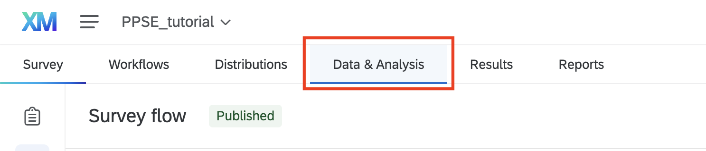
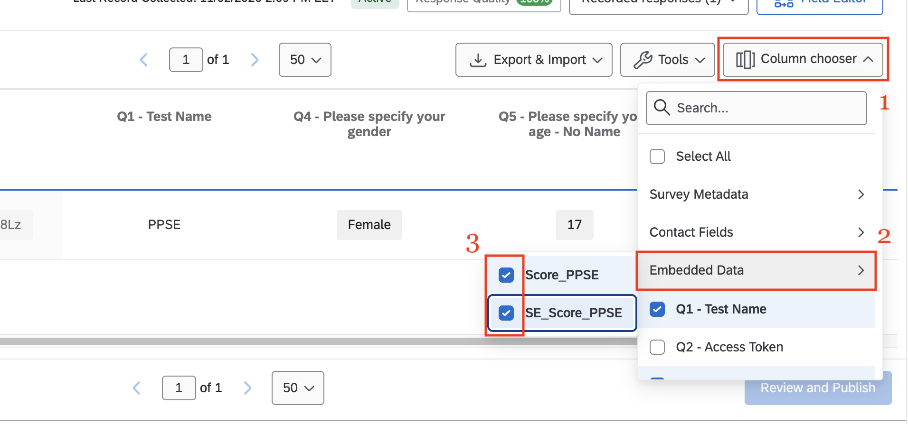
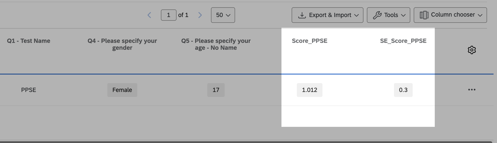

After data collection, you can access the data through your Qualtrics account, as with any other Qualtrics survey. However, one last step adds the score and its standard error to the results table.

Go to the **Data & Analysis** tab.

{width="700"}

Click **Column chooser** → **Embedded data**, and select the `Score_<Name>` and `SE_Score_<Name>` fields so they appear as columns in the table.



The two values then appear alongside the other answers, as in the example response below.



------------------------------------------------------------------------

With this Qualtrics setup, the responses to each administered item are not stored in Qualtrics. Researchers who need these responses can download them as a separate CSV file using the form below:

Enter the Test Name and the Access Token to download the results. Optionally, you can limit the results to a date range.

```{=html}
<script>
function downloadData() {
  const token = document.getElementById("AccessToken").value;
  
  const params = {
    catName: document.getElementById("catNameInput").value,
    from: document.getElementById("fromDateInput").value,
    to: document.getElementById("toDateInput").value,
  };
  const ResultsFileName = params.catName + "-results.csv";
  
  //Qualtrics part 
  // const qualtrics = {
  //   surveyName: document.getElementById("surveyNameInput").value,
  //   qualtricsToken: document.getElementById("qualtricsToken").value
  // };

  if (!token || !params.catName) {
    alert("Please fill in all required fields: Access Token & Test Name.");
    return;
  }
  
  let url = `https://qualcat.duckdns.org/api/v0/get-data?catName=${encodeURIComponent(params.catName)}&from=${encodeURIComponent(params.from)}&to=${encodeURIComponent(params.to)}`

  console.log(url) //debug
  fetch(url, {
    method: "GET",
    headers: {"x-api-key": token   
        }
    })
    .then(response => {
        if (!response.ok) {
            throw new Error("Download failed: " + response.statusText);
        }
        return response.blob();   // CSV comes as a blob
    })
    .then(blob => {
        const url = window.URL.createObjectURL(blob);
        const a = document.createElement("a");
        a.href = url;
        a.download = ResultsFileName;   // <-- file name for the download
        document.body.appendChild(a);
        a.click();
        a.remove();
        window.URL.revokeObjectURL(url);
    })
    .catch(err => {
        console.error("Download error:", err);
        alert("Could not download file.");
    });
}
</script>
```
```{=html}
<div style="
  background-color: rgba(24, 188, 156, 0.1);  /* #18bc9c with 20% opacity */
  border: 1px solid #18bc9c;
  padding: 20px;
">
  <div class="d-flex gap-3 mt-1">
  <!-- 1st row -->
   <fieldset class="flex-fill">
    <div class="form-floating">
    <input type="text" class="form-control" id="catNameInput" placeholder="CAT Name">
    <label for="catNameInput">Test Name*</label>
    </div>
  </fieldset>
  
  <fieldset class="flex-fill">
    <div class="form-floating">
    <input type="password" class="form-control" id="AccessToken" placeholder="Access Token" autocomplete="off">
    <label for="AccessToken">Access Token*</label>
    </div>
  </fieldset>
 
   <fieldset class="flex-fill">
  <button class="btn btn-outline-success" onclick="downloadData()">
  Download Responses
  </button>
  </fieldset>
  </div>

  <div class="d-flex gap-3 mt-2">
  <fieldset class="flex-fill">
    <div>
    <label class="col-form-label" for="fromDateInput">From Date</label>
    <input type="date" class="form-control" id="fromDateInput" name="from" placeholder="">
    </div>
  </fieldset>
  
  <fieldset class="flex-fill">
    <div>
    <label class="col-form-label" for="toDateInput">To Date</label>
    <input type="date" class="form-control" id="toDateInput" name="to" placeholder="">
    </div>
  </fieldset>
      
  </div>
</div>
```
::: callout-note
For the TCAT: Enter `TCAT` as the test name and `Tok1234` as the access token.

For the PPSE: Enter `PPSE` as the test name and `Tok1234` as the access token.
:::
